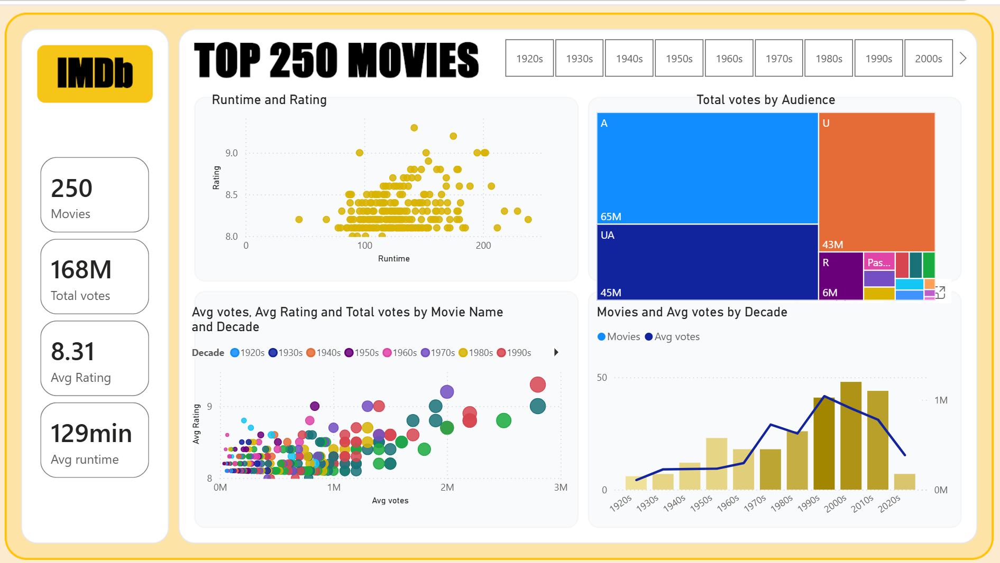

# 🎬 IMDb Top 250 Movies - Analytics Dashboard

An interactive **Power BI** dashboard exploring the **IMDb Top 250 movies** list: audience ratings, vote volumes, runtimes, content ratings, and release trends across decades.



## 🗃️ Data Source

The IMDb Top 250 movies dataset (250 top-rated titles with ratings, votes, runtime, content rating, genre, and release year), cleaned and modeled in Power Query.

## 🔍 Key Findings

- The Top 250 span **168M total audience votes** with an **average rating of 8.31** and an **average runtime of 129 minutes**.
- **A-rated titles draw the largest vote volume (65M)**, ahead of UA (45M) and U (43M); R-rated titles account for 6M votes.
- The **1990s and 2000s contribute the most titles** to the list, while average votes per movie peak around the same decades - recent classics dominate audience engagement.
- Ratings cluster tightly between 8.0 and 9.0 regardless of runtime; very long runtimes do not hurt ratings.

## 📊 Dashboard Visualizations

- **Runtime vs Rating scatter:** every title plotted by runtime and IMDb rating.
- **Total Votes by Audience rating (treemap):** vote volume across content ratings (A, UA, U, R, and others).
- **Votes & Rating by Movie and Decade (bubble chart):** average votes vs average rating per title, colored by decade.
- **Movies & Average Votes by Decade (combo chart):** title counts and average votes per decade from the 1920s to the 2020s.
- **Decade slicer:** filter the whole report by release decade.

## 🛠 Tech Stack

- **Business Intelligence:** Microsoft Power BI Desktop
- **ETL & Data Cleaning:** Power Query (missing value handling, data type formatting, column splitting)
- **Calculations:** DAX measures for aggregations and KPI cards

## 📁 Repository Structure

```text
imdb-movie-analytics/
│
├── IMDB.pbix
├── screenshots/
│   └── top-250-movies-dashboard.png
└── README.md
```

## 📁 How to View

1. Download `IMDB.pbix` from this repo.
2. Open it in **Power BI Desktop**.
